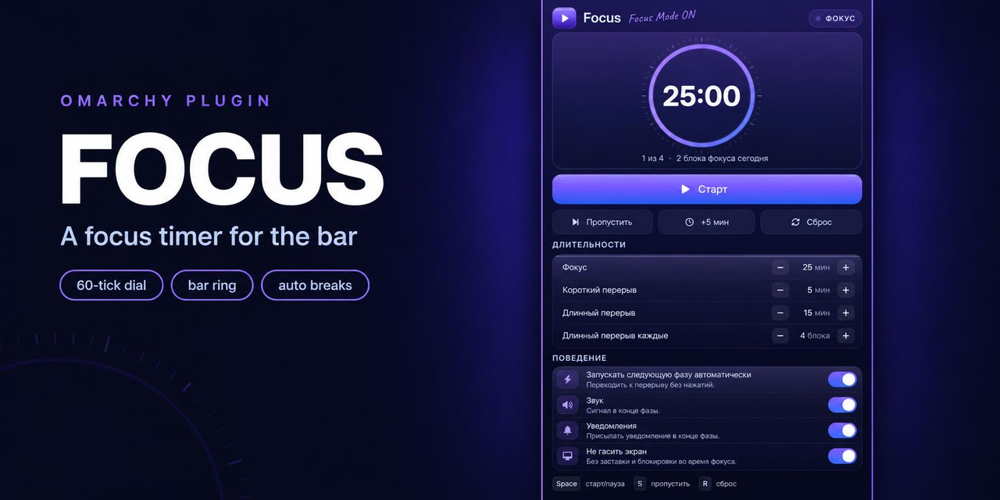
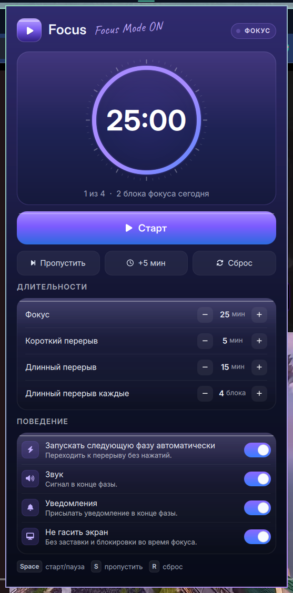
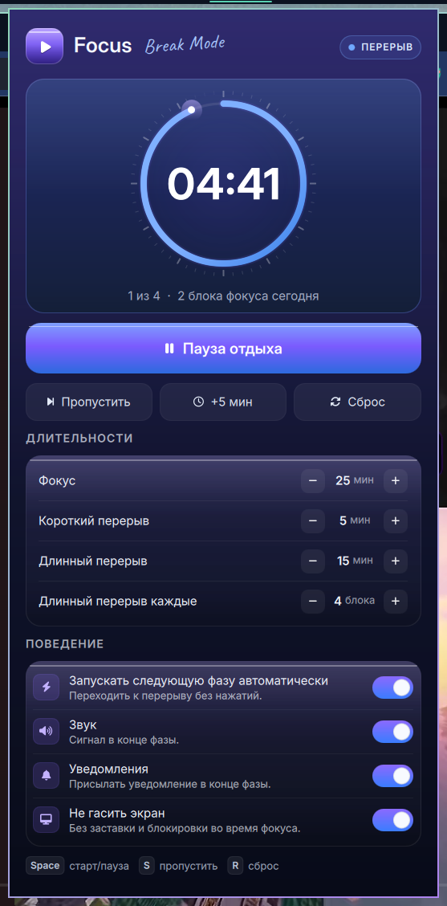

# Focus

A focus/break timer that lives in the Omarchy bar and opens into a panel built
like an instrument: a 60-tick minute scale, a gradient sweep that drains
clockwise, and the figures in the middle of the dial. The bar keeps a matching
ring, so the remaining time is visible without opening anything. One timer is
shared by every monitor, and a finished block announces itself with a sound and
a desktop notification.

## Screenshots

| Focus | Break |
|---|---|
|  |  |

Violet is focus, blue is a break: the badge, the dial, the hero face and the
handwritten note all switch hue, so the mode is read at a glance.

## Install

```bash
git clone https://github.com/valerkaaa/omarchy-focus.git /tmp/omarchy-focus
cp -r /tmp/omarchy-focus ~/.config/omarchy/plugins/honor.pomodoro
omarchy plugin enable honor.pomodoro
```

The plugin targets the Omarchy shell (Quickshell). It needs `node` only for the
test suite, and the interface font `Inter` / `Inter Display` for the panel; the
handwriting face ships with the plugin.

## What it does

- **Focus → short break → focus → … → long break.** The long break comes after
  every Nth focus block (4 by default), then the cycle starts over.
- **Auto-start** carries you from focus into break and back without a click;
  turn it off and every phase waits for you.
- **Stay awake** borrows the shell's idle inhibitor for the length of a focus
  block, so a 25-minute block cannot end in a locked screen. A stay-awake you
  had switched on yourself is left on afterwards.
- **The bar mark beats once** when a phase ends: it steps out slightly with a
  halo under it and settles, driven by the phase change itself so it also fires
  for a block that finished while the panel was closed.
- **Today's total** counts completed focus blocks and resets at midnight. The
  number survives a shell restart; a running block does not, because a
  countdown that silently kept going while the shell was down would fire a
  notification for a block nobody remembers starting.
- **The primary button names its phase**: Start / Pause / Resume in focus,
  Start break / Pause break / Resume break in a break, so "pause" never reads
  as pausing the rest itself.
- **Keyboard**: `Space` start/pause, `S` skip the phase, `R` reset. The bar
  mark is also a control: left click opens the popup, right click
  starts/pauses, middle click skips.

## The bar mark

A ring that drains clockwise as the phase runs, around a state glyph: a play
triangle before the first block (`idle`), a dot while it counts (`running`),
pause bars while it is held (`paused`). The ring wears the panel's violet
(#8A6BFF) so the widget is recognisable from the bar; a break draws it in a
lighter violet, and the last minute of a focus block turns it the theme's
urgent colour.


## The panel

The popup is one lit surface rather than a list on a flat card: a night-blue
gradient with a violet bloom at the top, a gradient hero holding the countdown,
one primary action, and two grouped blocks for the numbers and the switches.

- Colour and depth come from gradients, a one-pixel specular on the raised
  faces and a hairline border — never from decoration that competes with the
  countdown.
- The phase is named in the header badge (ФОКУС / ПЕРЕРЫВ / ДЛИННЫЙ ПЕРЕРЫВ) and
  the mode carries its own hue: violet for focus, blue for a break, in the
  badge, the ring, the hero face and the handwritten note. One glance answers
  which mode is running.
- The countdown sits inside a dial: a sixty-tick minute scale outside the
  sweep, a faint track, a gradient sweep that drains clockwise from twelve, a
  soft bloom and a lit pip at the head. The dial is the only progress read-out,
  so there is no second bar repeating it.
- The head pips outward on every start and pause and settles back; the whole
  minute scale clicks round 3° on the same spring, so the dial reads as one
  mechanism instead of a ring with a dot on it. Counted in
  `debugLayout().kicks`, with the live shift in `.tickShift` degrees, so the
  gesture can be proven without a video.
- The mark in the header is a raised tile — shadow, face gradient, inner
  shade, specular line, knocked-out glyph — not a flat rounded square.
- The settings blocks are glass slabs: a lighter top face, a violet tint in the
  top corner, a bright specular edge and a shaded bottom. Restrained on
  purpose — a full frosted blur would cost the rows their contrast.
- The type is Inter Display for the figures and Inter for the prose, with a
  bundled Caveat for the single handwritten "Focus Mode ON" mark. The bar keeps
  the shell's own font.
- Everything read in the panel is at least 11 px at the 12 px base and scales
  with `[font] base-size`; captions are a 0.55–0.72 tint of the ink rather
  than a darker colour.
- The card is drawn inside the panel with `padding: 0`, so the gradient reaches
  the rounded edge the theme gives the popup.

## Settings

Everything is stored in the bar entry in `~/.config/omarchy/shell.json` and can
also be changed from the popup.

| key | default | meaning |
|---|---|---|
| `focusMinutes` | 25 | length of a focus block |
| `shortBreakMinutes` | 5 | length of a short break |
| `longBreakMinutes` | 15 | length of a long break |
| `longBreakEvery` | 4 | focus blocks between long breaks |
| `autoStart` | true | start the next phase automatically |
| `sound` | true | chime when a phase ends |
| `notify` | true | desktop notification when a phase ends |
| `stayAwake` | true | inhibit idle/screensaver/lock during focus |

```bash
omarchy bar set honor.pomodoro focusMinutes 50 --json
omarchy bar set honor.pomodoro autoStart false
```

Note that `omarchy bar set` stores booleans as the strings `"true"`/`"false"`;
the plugin coerces both forms, so either works.

## IPC

```bash
omarchy-shell honor.pomodoro status        # focus:running:24:58:2
omarchy-shell honor.pomodoro remaining     # 24:58
omarchy-shell honor.pomodoro open          # also: close, show, hide
omarchy-shell honor.pomodoro start         # also: pause, toggle
omarchy-shell honor.pomodoro skip          # move to the next phase, uncounted
omarchy-shell honor.pomodoro finish        # complete this phase now, counted
omarchy-shell honor.pomodoro reset         # back to an untouched focus block
omarchy-shell honor.pomodoro add           # +5 minutes to this block
```

`status` prints `phase:state:remaining:completedToday`, where state is
`running`, `paused` or `idle`.

## Files

```
manifest.json     kinds, entry points, settings schema
Panel.qml         bar button, the focus panel, IPC
Service.qml       the single timer: phases, ticks, persistence, idle inhibit
Model.js          pure helpers (durations, next phase, clock, state parsing)
ProgressMark.qml  the ring and the state glyph in the bar
ProgressRing.qml  the panel hero dial: ticks, gradient sweep, sprung head
LogoMark.qml      the raised violet tile with the play glyph
GradientButton.qml  the primary Start/Pause face
SoftButton.qml      the quiet Skip / +5 / Reset pills
LengthRow.qml       a "− 25 min +" length row
BehaviorRow.qml     an icon, a title, a hint and the gradient switch
SwitchPill.qml      the gradient switch itself
SectionLabel.qml    popup section header
fonts/Caveat.ttf    the handwriting face (SIL OFL, licence beside it)
i18n/             en.json, ru.json
tests/model.test.js
```

State lives in `~/.local/state/omarchy/plugins/pomodoro/state.json` (today's
count and the cycle position) and, while a focus block inhibits idle, a marker
file next to it records whether the inhibitor was borrowed or already on.

## Tests

```bash
node tests/model.test.js
omarchy plugin validate .
```

The suite covers the pure decisions: setting coercion, phase durations, the long
break cadence, clock rounding, progress clamping, notification escaping, and
validating what is read back from disk. It does not cover the QML surfaces,
timers, or the idle inhibitor — those are proven by the running widget:

```bash
omarchy-shell honor.pomodoro start
omarchy-shell honor.pomodoro status
omarchy-shell idle status | jq -r .stayAwake   # true while focusing
```

## License

MIT. See `LICENSE`.
